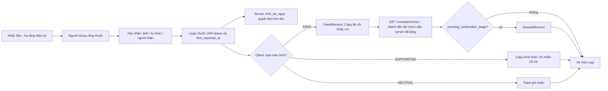
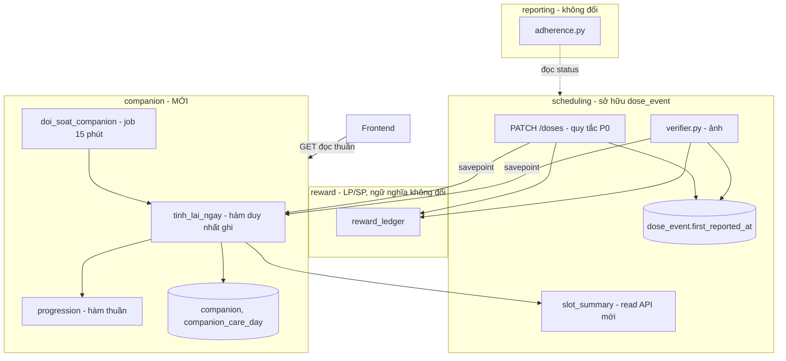
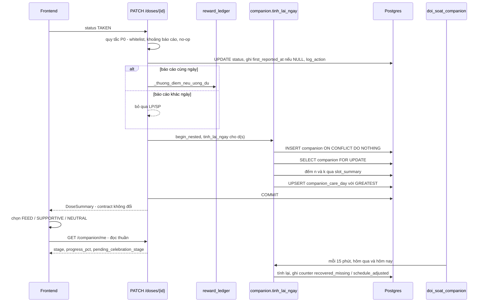
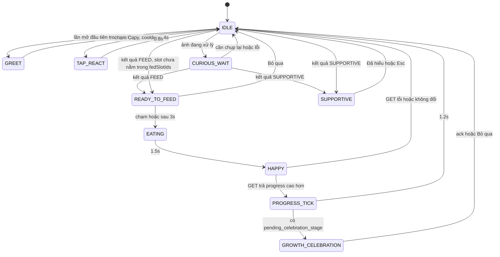

# Capybara Companion — Kế hoạch triển khai cuối cùng

> **Trạng thái:** CHỜ PRODUCT OWNER DUYỆT. Chưa được phép implement.
> **Phiên bản:** R2 (2026-11-14). Bản này tinh chỉnh R1 ở ba điểm: phục hồi credit bị thiếu, tính lại tiến độ khi lịch thay đổi, và tách màn ăn mừng khỏi điều kiện lớn lên. Tóm tắt ở §0.
> **Phạm vi file:** kế hoạch cấp tính năng, trải qua nhiều phase. Khi bắt đầu implement, mỗi `TASK-CAPY-xx` được tách thành một file trong `/tasks/` theo [`tasks/README.md`](../tasks/README.md), rồi đưa vào sprint trong `/planning/sprints/`.
> **Vì sao đặt ở `planning/`:** [`planning/README.md`](./README.md) định nghĩa thư mục này là nơi trả lời "làm gì trước, làm gì sau". `docs/superpowers/plans/` chứa plan do skill sinh cho từng tính năng admin, không phải lộ trình nhiều phase.
> **Quy ước nhãn:** `[OBSERVED]` là đã kiểm chứng trong source. `[INFERRED]` là suy luận từ code đã đọc. `[PROPOSED]` là đề xuất mới. `[UNKNOWN]` là chưa kiểm chứng.
> **Về test:** P0 (TASK-CAPY-03 đến 09) đã được kiểm tra tập trung trên Postgres local ngày 2026-11-14; full suite chưa chạy. Môi trường lập kế hoạch không có dependency Python (không có `sqlalchemy`, không có venv).

---

## 0. Thay đổi R2 so với R1

| # | R1 | R2 | Vì sao |
|---|---|---|---|
| 1 | Credit được quyết định từ thời điểm `now` trong bộ nhớ, ghi vào bảng `companion_dose_credit`. Hook lỗi thì mất credit, chỉ đối soát được ở P2 bằng cách parse audit log. | **Dữ kiện lâm sàng `dose_event.first_reported_at` (P0)** cộng **một hàm tính lại tất định** `tinh_lai_ngay`. Hook và **job đối soát chạy mỗi 15 phút (P1)** cùng gọi hàm này. Bỏ bảng credit. | Phục hồi được mà không cần parse text; idempotent tự nhiên; có quan sát được (counter `recovered_missing`). |
| 2 | Lưu ảnh chụp `day_units_after` tại lúc credit. Khi bác sĩ giảm hoặc huỷ liều trong ngày thì bị tính thiếu (hàng 7b, "chấp nhận được"). | Bảng `companion_care_day` được tính lại từ trạng thái hiện tại cho **hôm qua và hôm nay**, áp `GREATEST`. Các trường hợp tính thiếu do dừng hoặc sửa phác đồ được **sửa trong ≤ 1 chu kỳ job**. Tính dư khi tăng liều được **giới hạn và ghi rõ** (§4.7). | Không im lặng chấp nhận sai. |
| 3 | AWAITING_CAREGIVER được tính tiến độ ngay, và FeedMoment chạy cho cả AWAITING. | **AWAITING không có màn ăn mừng và chưa được tính tiến độ.** Chỉ khi người thân duyệt TAKEN thì liều mới được tính, theo ngày bệnh nhân báo cáo. Bị từ chối thì không bao giờ được tính. Đường "ảnh sai 3 lần, không có người thân" thì vẫn được tính tiến độ nhưng **không có màn ăn mừng**. | Ảnh không khớp có thể là uống nhầm thuốc. Không được ăn mừng trên một tín hiệu an toàn. |
| 4 | D-16: không thêm cột vào `dose_event`. | D-16 được sửa: thêm `first_reported_at` (nullable, không backfill) ở P0. Migration P0 là `0064`, P1 là `0065`. | Điều kiện của mục 1. |
| 5 | 33 task. | 36 task, đánh số lại theo thứ tự phụ thuộc (bảng đối chiếu ở §6). | — |

---

## 1. Executive Summary

**Mục tiêu sản phẩm.** Biến mỗi lần xác nhận liều thuốc thành một khoảnh khắc chăm sóc: người dùng cho Capy ăn, và Capy lớn dần từ bé con thành "Capy y tá" theo những ngày họ giữ được nếp quản lý thuốc. Định vị cảm xúc: **"Capy chăm bạn, bạn chăm Capy."**

**MVP khuyến nghị (P0 + P1).**
1. **P0** vá độ tin cậy của `PATCH /doses/{id}` ở runtime legacy, tách ghi nhận lâm sàng khỏi điều kiện nhận thưởng, và thêm dữ kiện `first_reported_at`.
2. **P1** làm "Cho ăn và lớn lên": tiến độ lưu ở server và được tính lại tất định, có job đối soát, giai đoạn 1→2 có art, 9 state hành vi nhẹ, chạy sau feature flag.

**Ngoài phạm vi (non-goals).**
- Không thêm tiền tệ hiển thị. Không quy đổi sang LP/SP hay quà.
- Không streak, không bảng xếp hạng, không cosmetic theo giờ.
- Capy không bao giờ đói, ốm hay buồn.
- Không có offline queue, không có `POST /feed`.
- Người thân và bác sĩ không xem Capy.

**Quyết định kiến trúc tổng thể.**
- Domain `companion` độc lập với LP/SP và với tuân thủ lâm sàng.
- Mọi lần ghi đều đi qua **một hàm tính lại tất định** `tinh_lai_ngay(patient, ngày)`. Hàm khoá dòng `companion` của bệnh nhân bằng `FOR UPDATE`, đếm lại từ `dose_event`, rồi upsert `companion_care_day` với `GREATEST`.
- Hàm này được gọi theo sự kiện (trong savepoint, cùng transaction xác nhận liều) và bởi job đối soát chạy mỗi 15 phút.
- `GET /companion/me` là đọc thuần, không có tác dụng phụ.
- Frontend dùng ảnh WebP trong suốt cộng GSAP và một reducer hành vi. **Màn ăn mừng là quyết định hiển thị ở client, tách khỏi điều kiện lớn lên ở server.**

**Kết luận: CONDITIONAL GO.** Được bắt đầu P0 và phần code P1 sau khi PO duyệt các quyết định ở §10. **Chưa được bật flag ở production** cho tới khi qua hết blocker ở §8 và §9.

---

## 2. Repository Evidence

### 2.1 Kiến trúc đã kiểm chứng `[OBSERVED]`

| Hạng mục | Bằng chứng |
|---|---|
| Frontend | Next 16, React 19, Tailwind 4, `gsap` + `@gsap/react` ([`frontend/package.json`](../frontend/package.json)). GSAP đang dùng ở [`frontend/src/components/mascot/capy-mascot.tsx`](../frontend/src/components/mascot/capy-mascot.tsx). |
| Backend | FastAPI, SQLAlchemy (`autoflush=False`, [`backend/db/base.py:31`](../backend/db/base.py)), Alembic tới `0063`, Postgres ở production, SQLite trong test. |
| Runtime liều | `dose_runtime_mode: Literal["legacy","shadow","v2"]`, mặc định `legacy` ([`backend/config.py:324`](../backend/config.py)). Endpoint liều chỉ rẽ nhánh khi `== "v2"` ([`backend/api/dose_routes.py:54`](../backend/api/dose_routes.py), `:204`), nên **ở `shadow` vẫn phục vụ từ `dose_event`**. Ở `shadow`, prescription service ghi thêm dòng V2 ([`backend/services/prescription/service.py:71-72`](../backend/services/prescription/service.py)). |
| Ai ghi status `dose_event` | Grep toàn bộ `backend/` chỉ thấy bốn nơi: `PATCH /doses/{id}` ([`dose_routes.py:240-260`](../backend/api/dose_routes.py)); `verifier.py` ba nhánh ([`backend/services/photo_verification/verifier.py:318`](../backend/services/photo_verification/verifier.py) khớp ảnh → TAKEN/DELAYED, `:354` → AWAITING_CAREGIVER, `:362` → TAKEN khi không có người thân); job chốt MISSED ([`backend/services/dose_lifecycle.py:87`](../backend/services/dose_lifecycle.py)); dừng phác đồ ([`backend/services/scheduling/generator.py:205`](../backend/services/scheduling/generator.py)). Chatbot chỉ ghi log khi phân loại "TAKEN" ([`backend/agents/nodes/dose_confirmation_nodes.py`](../backend/agents/nodes/dose_confirmation_nodes.py)). |
| Ảnh sai 3 lần | `xac_dinh_next_action` trả `CAREGIVER_REVIEW` khi `attempt ≥ MAX_ATTEMPTS` ([`verifier.py:177-185`](../backend/services/photo_verification/verifier.py)). Có người thân `accepted` → AWAITING_CAREGIVER. Không có → TAKEN với 70% LP. Cả hai nhánh đều escalate mức trung bình ([`verifier.py:338-378`](../backend/services/photo_verification/verifier.py)). |
| Client gọi PATCH | Chỉ gửi `TAKEN`/`MISSED`: [`frontend/src/app/patient/page.tsx:337`](../frontend/src/app/patient/page.tsx), `:352`; [`frontend/src/app/patient/family/[id]/page.tsx:57`](../frontend/src/app/patient/family/[id]/page.tsx); [`frontend/src/lib/proto-store.tsx`](../frontend/src/lib/proto-store.tsx). |
| Xác minh ảnh | Chạy nền qua `BackgroundTasks` ([`backend/api/photo_routes.py:90`](../backend/api/photo_routes.py)), session riêng, tự commit ([`verifier.py:188-205`](../backend/services/photo_verification/verifier.py), `:379`). |
| Sinh lịch legacy | Chỉ có lịch hằng ngày. Các thuốc cùng giờ trong một phác đồ gộp thành một `dose_event` ([`generator.py:123`](../backend/services/scheduling/generator.py)). Liều đã qua giờ lúc duyệt thì không được sinh. Sửa phác đồ **xoá** các liều PENDING tương lai rồi sinh lại (`:183`). Dừng phác đồ chuyển chúng sang `CANCELLED` (`:205`). |
| Sinh lịch V2 | Chỉ có `DAILY_AT_TIMES`, interval 1 ngày, có thể kèm chu kỳ on/off ([`backend/services/scheduling/occurrence_generator.py:64-95`](../backend/services/scheduling/occurrence_generator.py)). **Chưa runtime nào tạo được lịch theo tuần.** |
| State machine V2 | TAKEN chỉ hợp lệ trong window. DELAYED chỉ hợp lệ trong cùng ngày địa phương. Trạng thái kết thúc không đổi được ([`backend/services/scheduling/dose_state.py:44`](../backend/services/scheduling/dose_state.py), `:170-203`). |
| `dose_event` | Không có `taken_at` hay `updated_at`. Chỉ có index trên `patient_id` và `prescription_id` ([`backend/db/models.py:1613-1632`](../backend/db/models.py)). |
| Scheduler | APScheduler với `SQLAlchemyJobStore`, nhiều job theo interval (ví dụ `_run_dose_closeout`, `minutes=15`) ([`backend/services/escalation_scheduler.py:115-260`](../backend/services/escalation_scheduler.py)). |
| Partial index đa dialect | Convention khai báo cả `postgresql_where` và `sqlite_where` ([`backend/db/models.py`](../backend/db/models.py), `PatientRewardEvent.__table_args__`). |
| Reward LP/SP | [`backend/services/reward_ledger.py`](../backend/services/reward_ledger.py): `award_dose_on_time` (:200), `apply_confirmation_method_penalty` (:281), `_xet_thuong_chuoi` (:395), `get_summary` (:422, đọc thuần). |
| Tuân thủ lâm sàng | [`backend/services/reporting/adherence.py`](../backend/services/reporting/adherence.py): TAKEN chia cho số liều đã đến hạn, tách khỏi reward. |
| Audit | `log_action()` ghi `system_audit_logs` trong transaction của route ([`backend/services/audit.py:63`](../backend/services/audit.py)), nhưng trả `None` khi không có `current_user`, tức là verifier nền không dùng được. PATCH liều hiện **không** ghi audit. |
| Pattern khoá | `with_for_update()` đã có ở [`backend/services/doctor_handoff.py:227`](../backend/services/doctor_handoff.py), [`backend/services/prescription/service.py:199`](../backend/services/prescription/service.py). |
| UI bệnh nhân | Thẻ quote Capy ngẫu nhiên ([`page.tsx:386-403`](../frontend/src/app/patient/page.tsx)), có `capy_khoc` ([`frontend/src/lib/capy-quotes.ts`](../frontend/src/lib/capy-quotes.ts)); overlay "Xong rồi!" (`:755-779`); toast "điểm thấp hơn" (`:338`); câu chữ lỗi thời (`:684`). `CapySheet` dùng lại được ([`frontend/src/components/capy/capy-ui.tsx:66`](../frontend/src/components/capy/capy-ui.tsx)). |
| Asset | Sticker `frontend/public/capy_*.png` 512px dạng palette, không alpha, chữ in sẵn. `mascot/capy-mascot.svg` chỉ bọc raster. `globals.css` không có `prefers-reduced-motion`. |
| CI | [`.github/workflows/ci.yml`](../.github/workflows/ci.yml) chạy ruff + pytest. **Job `lint-and-test` không có service Postgres** (comment ở dòng 72–75), nên mọi test cần DB thật bị SKIP trên CI, gồm cả [`tests/test_dose_status_update.py`](../tests/test_dose_status_update.py). Chỉ job `golden-smoke` có Postgres. Deploy qua [`.github/workflows/deploy.yml`](../.github/workflows/deploy.yml). Railway chạy `scripts/safe_migrate.py` ở preDeploy ([`railway.json`](../railway.json)). |

### 2.2 Lỗ hổng đã biết, cần regression test

**Cập nhật 2026-11-14:** V-1 đến V-6 đã được **tái hiện bằng test chạy trên Postgres thật** (baseline 7/7 failed), và **đã sửa** ở TASK-CAPY-08 (7/7 passed). Xem [`tasks/TASK-CAPY-03-regression-test-dose-status.md`](../tasks/TASK-CAPY-03-regression-test-dose-status.md).

| ID | Mô tả | Mức bằng chứng |
|---|---|---|
| V-1 | PATCH nhận chuỗi status tuỳ ý: `status: str` ([`backend/models/schemas.py:1465`](../backend/models/schemas.py)), route gán thẳng | `[OBSERVED — tái hiện bằng test, đã sửa]` |
| V-2 | Bệnh nhân tự đặt `CANCELLED`, bị loại khỏi mẫu số điểm ([`reward_ledger.py:153`](../backend/services/reward_ledger.py)) và làm sai hồ sơ lâm sàng | `[OBSERVED — tái hiện bằng test, đã sửa]` |
| V-3 | *(Mô tả sửa 2026-11-14 khi viết test.)* Mức trừ tự khai gắn với `previous_status` ([`dose_routes.py:285`](../backend/api/dose_routes.py)), nên: (a) **bấm "Bỏ qua" (PENDING→MISSED) bị ghi phạt ngay**, dù không được cộng gì, khiến SP có thể âm; (b) sau đó MISSED→TAKEN cộng đủ và báo "+20" thay vì mức tự khai. Tổng ròng vẫn đúng, nhưng sai chỗ và sai số hiển thị. | `[OBSERVED — tái hiện bằng test, đã sửa]` |
| V-4 | Xác nhận lùi ngày không giới hạn vẫn cộng LP cho ngày cũ ([`dose_lifecycle.py:68`](../backend/services/dose_lifecycle.py)) | `[OBSERVED — tái hiện bằng test, đã sửa]` |
| V-5 | Gửi lại TAKEN sau `window_end` hạ TAKEN xuống DELAYED | `[OBSERVED — tái hiện bằng test, đã sửa]` |
| V-6 | PATCH không ghi audit (trái BR-1.5) | `[OBSERVED — tái hiện bằng test, đã sửa]` |
| V-7 | Race trong `award_dose_on_time` khi hai transaction chạy song song. Chỉ tái hiện được trên Postgres. | `[INFERRED]`. Ngoài phạm vi sửa; là rủi ro R-4. |

### 2.3 Trạng thái runtime production: **BLOCKER B-1**

- Trong repo không có giá trị `DOSE_RUNTIME_MODE` nào (`railway.json`, `Dockerfile`, `docker-entrypoint.sh`, `.env.example`, `deploy.yml`, `.env` local). [`docs/DEPLOY.md`](../docs/DEPLOY.md) ghi env nằm trên Railway.
- Bằng chứng duy nhất là comment ngày 2026-08-20 trong [`backend/services/dose_push_reminder.py`](../backend/services/dose_push_reminder.py): *"production dang shadow"*. Mức `[INFERRED, yếu]`.
- **Chưa xác định được. Không mặc định là legacy.** Companion hỗ trợ `legacy`/`shadow` và tự tắt có chủ đích ở `v2`.
- **TASK-CAPY-01 (2026-11-14): UNKNOWN.** Máy dev không có Railway CLI lẫn `psql`. `.env` local không có key `RAILWAY_*` nào, nên không phải bản kéo từ `railway variables --kv` và không dùng làm bằng chứng được. Cần người có quyền Railway (xem [`tasks/TASK-CAPY-01-xac-minh-runtime-production.md`](../tasks/TASK-CAPY-01-xac-minh-runtime-production.md)).

### 2.4 Giả định chưa kiểm chứng `[UNKNOWN]`

- Có client ngoài frontend gọi `PATCH /doses` với status khác không.
- Số người dùng thật (ảnh hưởng chi phí của job đối soát), và lịch chuyển sang V2.
- Năng lực sản xuất art. Phản ứng của người dùng 60+.
- Hành vi `FOR UPDATE` cùng `ON CONFLICT` dưới tải thật.

---

## 3. Product Experience

### 3.1 Vòng cảm xúc



### 3.2 Màn ăn mừng tách khỏi điều kiện lớn lên `[PROPOSED]`

Màn ăn mừng là **quyết định hiển thị ở client**, chỉ dựa trên kết quả của chính hành động vừa làm. Việc Capy có lớn hay không là **quyết định của server** (§4). Hai thứ có thể khác nhau, và đó là chủ ý.

| Kết quả của hành động | Màn hình (client) | Lớn lên (server) |
|---|---|---|
| Ảnh khớp → TAKEN/DELAYED, liều của hôm nay | **FEED**: món ăn, Capy ăn, nhảy vui, thanh tiến độ | Có (cùng ngày) |
| Tự khai TAKEN, hoặc người thân/bác sĩ xác nhận hộ, liều của hôm nay | **FEED** | Có |
| Ảnh sai 3 lần, có người thân → AWAITING_CAREGIVER | **SUPPORTIVE**: Capy bình thản (tư thế `idle`), "Ảnh chưa khớp đơn thuốc. Người thân sẽ xem giúp bạn. Nếu không chắc đã uống đúng thuốc, hãy hỏi bác sĩ hoặc dược sĩ." | **Chưa.** Chỉ được tính nếu người thân duyệt TAKEN. |
| Ảnh sai 3 lần, không có người thân → TAKEN (70% LP) | **SUPPORTIVE** (cùng lời nhắn, bỏ câu về người thân) | Có, như tự khai |
| Báo cáo trễ (liều của ngày trước) | **NEUTRAL**: toast "Đã ghi lại. Cảm ơn bạn" | Không |
| MISSED / "Bỏ qua liều này" | **NEUTRAL**: toast trung tính kèm "hỏi bác sĩ hoặc dược sĩ" | Không |
| Người thân duyệt AWAITING sau đó | Không có màn ăn mừng hồi tố. Lần mở app sau, thẻ Capy chạy PROGRESS_TICK nếu % đã tăng. | Có, tính cho ngày bệnh nhân báo cáo |

Chi tiết FEED:
- Món ăn theo buổi của slot: lá (sáng), dưa hấu (trưa), quýt (tối).
- Một chạm để cho ăn; không chạm thì tự ăn sau 3 giây. Nút "Bỏ qua" có từ frame đầu tiên. Toàn bộ ≤ 3,5 giây.
- Chip "+N điểm" chỉ hiện nhỏ (D-15).

### 3.3 Lớn lên

- Người dùng chỉ thấy tên giai đoạn và thanh "% đến giai đoạn tiếp theo". Không có con số tích luỹ.
- Trong một giai đoạn, Capy to dần theo scale (giai đoạn 1 từ 0,82 lên 0,95).
- Sheet "Hành trình của Capy" có 4 giai đoạn; giai đoạn chưa tới là bóng mờ.

| Giai đoạn | Tên | Ngưỡng (ngày chăm sóc) | Art |
|---|---|---|---|
| 1 | Capy sơ sinh | 0 | P1 |
| 2 | Capy con | 3 | P1 |
| 3 | Capy nhỡ | 14 | P2, trước ngày 12 của pilot |
| 4 | Capy y tá (được trao mũ y tá) | 42 | P2, trước ngày 38 |

### 3.4 Tính cách nhân vật

- **Điềm tĩnh, tò mò, trìu mến.** Không đòi hỏi, không năn nỉ.
- Mỗi giai đoạn cần 5 tư thế: `idle`, `blink`, `eat-open`, `eat-closed`, `happy`. Thở, nghiêng đầu, chào và phản ứng khi chạm đều là transform GSAP trên 5 tư thế này.

### 3.5 Mốc lớn đầu tiên

- **Trigger:** tổng ngày chăm sóc ≥ 3, rơi vào khoảng ngày 3–4 với người uống đủ liều.
- `GrowthMoment` ~3,5 giây, bỏ qua được, nút "Tuyệt quá!" nhận focus.
- Chỉ hiện một lần trên mọi thiết bị (`celebrated_stage` cộng ack). Reload trước khi ack thì hiện lại đúng một lần.
- Lên giai đoạn trong lúc vắng mặt (do người thân duyệt, hoặc job đối soát phục hồi) thì chỉ hiện giai đoạn cao nhất, kèm câu "Capy đã lớn trong lúc bạn vắng".

### 3.6 Accessibility và an toàn y tế

- Reduced motion: không transform, không thở, không chớp mắt; chỉ crossfade ≤ 150ms giữa các tư thế.
- `FeedMoment`, màn SUPPORTIVE và `GrowthMoment` đều là `role="dialog"`, focus vào nút chính, đóng được bằng Esc, có `aria-live`.
- Vùng chạm ≥ 48px. Chữ ≥ 15px. Âm thanh mặc định tắt.
- Câu chữ không bao giờ nói "bằng chứng đã uống" và không bao giờ gợi ý uống bù.
- **Không ăn mừng trên tín hiệu an toàn:** ảnh không khớp (có thể là uống nhầm thuốc) luôn dẫn tới SUPPORTIVE, không bao giờ FEED.
- Bỏ `capy_khoc` khỏi vòng xoay ngẫu nhiên. Không có state buồn nào.

---

## 4. Final Progression Algorithm — "Ngày chăm sóc"

### 4.1 Vì sao dùng mô hình theo ngày

Mô hình chuẩn hoá theo tuần (bản V2) có bốn lỗi: liều tuần làm nhảy giai đoạn ngay lập tức; đợt điều trị ngắn lớn nhanh hơn; tuần không trọn vẹn bị thổi phồng; và phải giải thích "tuần neo" cho người dùng.

Mô hình theo ngày giới hạn **tối đa 1 ngày chăm sóc cho mỗi ngày lịch**. Thời gian trôi qua chính là giới hạn tốc độ.

### 4.2 Định nghĩa và công thức `[PROPOSED; hằng số là giả thuyết, cấu hình được]`

```
slot s              : 1 dòng dose_event (legacy/shadow). V2: 1 runtime group (P2).
d(s)                : ngay_vn(s.scheduled_at)

first_reported_at   : (cột mới ở P0, thuộc domain scheduling) thời điểm server ghi nhận
                      LẦN ĐẦU slot chuyển sang {TAKEN, DELAYED, AWAITING_CAREGIVER}.
                      Chỉ ghi một lần, không bao giờ ghi đè hay xoá.

eligible(s)         : s còn tồn tại VÀ s.status ≠ CANCELLED
growth_done(s)      : s.status ∈ {TAKEN, DELAYED}
                      VÀ s.first_reported_at IS NOT NULL
                      VÀ ngay_vn(s.first_reported_at) == d(s)

tinh_lai_ngay(p, d):                                  # hàm DUY NHẤT ghi tiến độ
    INSERT companion(p) ON CONFLICT DO NOTHING
    SELECT companion(p) FOR UPDATE                    # serialize theo bệnh nhân
    n = #{s : eligible(s), d(s) = d}                  # đếm SAU khi có khoá
    k = #{s : growth_done(s), d(s) = d}
    target = (n == 0) ? 0 : floor(DAY_UNITS × k / n)  # DAY_UNITS = 100
    UPSERT companion_care_day(p, d):
        units           = GREATEST(units, target)     # chỉ tăng
        eligible_count  = n                           # luôn là giá trị mới nhất
        completed_count = k
    trả về (units_trước, units_sau, completed_count_trước, eligible_count_trước)

growth_units = Σ_d companion_care_day.units
stage        = bậc cao nhất có growth_units ≥ {0, 300, 1400, 4200}
progress_pct = floor(100 × (growth − ngưỡng_hiện_tại) / (ngưỡng_kế − ngưỡng_hiện_tại))
```

**Ai gọi `tinh_lai_ngay`:**
1. Hook trong `PATCH /doses/{id}` (legacy) và trong `verifier` (ba nhánh), cho ngày `d(s)` của slot vừa đổi. Chạy trong savepoint.
2. Job đối soát mỗi `COMPANION_RECONCILE_MINUTES = 15`, cho **hôm qua và hôm nay** của các bệnh nhân trong cohort có hoạt động gần đây (§4.4).

### 4.3 Quy tắc nhận tiến độ

| Quy tắc | Nội dung |
|---|---|
| Hoàn thành | Status TAKEN hoặc DELAYED. Ảnh, tự khai, người thân hay bác sĩ đều như nhau. |
| Cùng ngày báo cáo | Dựa trên `first_reported_at`, tức lúc bệnh nhân (hoặc người xác nhận hộ) **báo cáo lần đầu**, không phải lúc người thân duyệt. **Đây là điều kiện nhận thưởng, không phải quy tắc ghi nhận lâm sàng** (§4.6). |
| AWAITING_CAREGIVER | Chưa được tính. Người thân duyệt TAKEN (bất kể hôm nào) thì hook tính lại ngày `d(s)`, và liều được tính **nếu bệnh nhân đã báo cáo trong ngày `d(s)`**. Người thân từ chối (MISSED) thì không bao giờ được tính. |
| Chỉ tăng | Mọi lần tính lại đều áp `GREATEST`. Sửa TAKEN thành MISSED **sau khi** đã tính thì không làm giảm (§4.7, T-3). |
| Không có lợi từ uống thêm | `k ≤ n` theo định nghĩa (slot hoàn thành là tập con của slot eligible), cộng trần 100 mỗi ngày. Chỉ slot do bác sĩ lên lịch mới được tính. |
| Không phụ thuộc giờ | Trễ trong ngày vẫn tính đủ. Xác nhận sớm trong ngày cũng tính. Trần theo ngày khiến việc dồn xác nhận không có lợi. |
| Bỏ liều | MISSED vẫn nằm trong `n`. Bỏ qua không bao giờ có lợi hơn uống. |
| Đổi lịch | `n` luôn đọc trạng thái hiện tại: liều `CANCELLED` hay bị xoá khi sửa phác đồ đều ra khỏi `n`. Job tính lại hôm qua và hôm nay nên **sửa được trường hợp tính thiếu** (§4.7). |
| Ngày không có liều | Không tạo dòng, không trừ gì. UI có thể hiện "Capy đang nghỉ ngơi". |
| Ngày đã khép lại | Job chỉ tính lại hôm qua và hôm nay. Ngày cũ hơn chỉ được tính lại khi có hook trên chính slot đó (ví dụ người thân duyệt một AWAITING cũ). Vì `GREATEST`, lần tính lại đó chỉ có thể làm tăng. |

### 4.4 Idempotency, concurrency, phục hồi và quan sát

- **Idempotency:** `tinh_lai_ngay` là hàm tất định của trạng thái DB cộng `GREATEST`. Gọi 1 lần hay 10 lần, từ hook hay từ job, đều cho cùng kết quả. Không cần bảng credit hay unique key theo slot.
- **Concurrency:** `INSERT … ON CONFLICT DO NOTHING`, sau đó `SELECT … FOR UPDATE` trên `companion(p)`. Chỉ đếm **sau khi** có khoá.
  - Ở READ COMMITTED, transaction đến sau chờ transaction đến trước commit, rồi đếm và thấy dữ liệu của nó. Kết quả cuối đúng.
  - Không có vòng khoá: hook khoá dòng `dose_event` của mình trước rồi mới khoá `companion`. Job không khoá `dose_event` nào.
- **Flush:** bắt buộc `db.flush()` trước khi đếm, vì `autoflush=False`.
- **Cô lập lỗi:** hook chạy trong `db.begin_nested()`. Nếu lỗi: ghi `logger.exception("companion_hook_failed", extra={patient_id, dose_id})`, rollback savepoint, và xác nhận liều vẫn được commit. `first_reported_at` nằm trên `dose_event` nên **vẫn được lưu**.
- **Phục hồi (P1):** job `doi_soat_companion` chạy mỗi 15 phút, đăng ký giống `_run_dose_closeout` trong [`escalation_scheduler.py`](../backend/services/escalation_scheduler.py).
  - Tập bệnh nhân cần xét: `{patient_id có dose_event.first_reported_at ≥ đầu ngày hôm qua (giờ VN)}` hợp với `{patient_id có companion_care_day.care_date ≥ hôm qua}`. Cả hai truy vấn đều có index (partial index mới, và PK).
  - Lọc theo cohort và mode ∈ {legacy, shadow}. Flag tắt thì job không làm gì.
  - Mỗi bệnh nhân chạy trong một transaction riêng; bệnh nhân này lỗi không chặn bệnh nhân khác.
- **Quan sát:** job so sánh giá trị trước và sau của từng `companion_care_day`.
  - `completed_count` tăng mà không có hook tương ứng thì `recovered_missing += 1`. Ghi **WARNING** kèm `patient_id` và `care_date`. Đây là dấu hiệu hook đang lỗi.
  - `eligible_count` giảm làm `units` tăng thì `schedule_adjusted += 1`, ghi INFO.
  - Cuối mỗi lần chạy, ghi một dòng INFO dạng JSON: `{"job":"doi_soat_companion","patients":N,"days":M,"recovered_missing":a,"schedule_adjusted":b,"errors":c}`. Không ghi PHI (ADR-0004 §5).
  - Ngưỡng cảnh báo vận hành (vào runbook): `recovered_missing > 0` ở hai lần chạy liên tiếp, hoặc `errors > 0`.
- **Giới hạn backfill khi bật flag:** job chỉ nhìn lại 2 ngày. `first_reported_at` chỉ có từ khi P0 được deploy. Vì vậy lần bật flag đầu tiên cộng tối đa 200 đơn vị, dưới ngưỡng giai đoạn 2 (300). Capy của mọi người vẫn bắt đầu là sơ sinh.

### 4.5 Ví dụ tính toán và edge case

Ngày lịch tới giai đoạn 2 / 3 / 4 (ngưỡng 3 / 14 / 42 ngày chăm sóc). "Job" nghĩa là được sửa trong ≤ 15 phút.

| # | Profile / sự kiện | Phép tính | Kết quả |
|---|---|---|---|
| 1 | 1 liều/ngày, 100% | 100 mỗi ngày | ngày 3 / 14 / 42 |
| 1b | 1 liều/ngày, bỏ 1 trong 7 ngày | trung bình ≈ 86 mỗi ngày | ngày 4 / 17 / 49 |
| 2 | 4 liều/ngày, 100% | 25 mỗi liều, trần 100 | ngày 3 / 14 / 42 (**giống #1**) |
| 2b | 4 liều/ngày, mỗi ngày 3/4 | 75 mỗi ngày | ngày 4 / 19 / 56 |
| 2c | 3 liều/ngày, mỗi ngày 2/3 | floor(66,6) = 66 | ngày 5 / 22 / 64 |
| 3 | 1 liều/tuần (*chưa runtime nào hỗ trợ*) | 100 mỗi tuần | tuần 3 / 14 / 42. Không nhảy giai đoạn; phần mở rộng ở TASK-CAPY-35 |
| 4a | Đợt 3 ngày, 100% | 300 | G2 đúng ngày 3 |
| 4b | Đợt 3 ngày, bỏ 1 liều | 200 | floor(100×200/300) = 66% đến G2; tiến độ được giữ |
| 4c | Đợt 7 ngày, 100% | 700 | G2 ngày 3, rồi floor(100×400/1100) = 36% đến G3 |
| 4d | Thuốc mạn 1×/ngày cộng kháng sinh 3×/ngày trong 5 ngày; luôn quên liều trưa | n = 4, k = 3 → 75 trong 5 ngày; sau đó n = 1 → 100 | Chuẩn hoá trên mọi phác đồ chạy song song |
| 5 | Bác sĩ tạm dừng 14 ngày | n = 0 | Đứng yên, không mất gì |
| 5b | Dừng phác đồ lúc 14h; 08:00 đã TAKEN, 20:00 bị CANCELLED | Hook lúc 08:00: n = 2 → 50. Job sau 14h: n = 1, k = 1 → 100 | **Đúng: 100** (job, `schedule_adjusted`) |
| 6a | Chu kỳ 21 on / 7 off, 100% | 21 mỗi 28 ngày | ngày 3 / 14 / 49 |
| 6b | Chu kỳ 5 on / 2 off, 100% | 5 mỗi 7 ngày | ngày 3 / ~18 / ~58 |
| 7a | Tăng 1→2 liều trong ngày, sau khi 08:00 đã xong | 08:00: n = 1 → 100. Thêm 20:00 → tính lại 50 → `GREATEST` giữ 100 | **Tính dư nếu bỏ liều 20:00** (≤ 50 đơn vị). Xem T-1. |
| 7b | Giảm 2→1 liều qua sửa phác đồ (liều 20:00 PENDING bị xoá) | 08:00: 50. Job: n = 1 → 100 | **Đúng: 100** (job) |
| 7c | Phác đồ mới duyệt lúc 14h | Liều 08:00 không được sinh → n chỉ đếm liều đã sinh | Đúng |
| 8 | Uống ngày D, báo cáo ngày D+1 | `first_reported_at` rơi vào D+1 ≠ D | Không tính, 0 LP; hồ sơ lâm sàng được ghi; màn NEUTRAL |
| 9 | PATCH TAKEN hai lần, hoặc ảnh khớp + PATCH | Hàm tất định | Một kết quả, không cộng đôi |
| 10 | Liều 06:00 VN (23:00 UTC hôm trước), xác nhận 06:10 | `ngay_vn` ở cả hai phía | Cùng ngày, được tính |
| 11a | AWAITING lúc 21:00 ngày D, người thân duyệt TAKEN ngày D+1 | `first_reported_at` ở D; hook tính lại D | Tính cho D. Bệnh nhân không bị phạt vì người thân duyệt chậm. |
| 11b | AWAITING, người thân từ chối (MISSED) | Không bao giờ thoả `growth_done` | Không tính; không cần thu hồi gì |
| 11c | Ảnh sai 3 lần, không có người thân → TAKEN | Thoả `growth_done` | Tính như tự khai; màn SUPPORTIVE, không FEED |
| 12 | Hook lỗi | Savepoint rollback; `first_reported_at` vẫn được lưu | Job phục hồi; `recovered_missing` ghi WARNING |
| 13 | P0 deploy trước P1 vài tuần, sau đó bật flag | Job chỉ nhìn lại 2 ngày | Tối đa 200 < 300; vẫn là Capy sơ sinh |
| 14 | TAKEN lúc 08:00, bệnh nhân tự sửa thành MISSED lúc 09:00 | Tính lại 0, `GREATEST` giữ 100 | **Tính dư** ≤ 100 đơn vị cho slot đó. Xem T-3. |
| 15 | Bác sĩ sửa liều của 5 ngày trước từ TAKEN sang MISSED | Hook tính lại ngày đó, `GREATEST` | Không đổi. Hồ sơ lâm sàng vẫn được sửa đúng. |

**Công bằng:** tiến độ bằng nhau trên mỗi ngày điều trị, bất kể tần suất hay số phác đồ chạy song song. Người theo chu kỳ lớn chậm hơn theo lịch tương ứng với số ngày không có thuốc. Đây là chính sách có chủ ý: tăng trưởng không đến từ thời gian không có thuốc. Cần PO duyệt (D-5).

### 4.6 Ghi nhận lâm sàng khác điều kiện nhận thưởng

| Mối quan tâm | Quy tắc `[PROPOSED]` | Domain |
|---|---|---|
| **Ghi lịch sử uống thuốc** | Bệnh nhân, và người thân có link `accepted`, được ghi `TAKEN`/`MISSED` cho liều có `d(s)` ∈ `[hôm nay − LATE_REPORT_DAYS, hôm nay]`. Đề xuất `LATE_REPORT_DAYS = 3`, **cần PM và bác sĩ chốt**. Ngoài khoảng trả 422. Bác sĩ không bị giới hạn ngày. **Người thân hoặc bác sĩ duyệt một liều AWAITING_CAREGIVER thì không bị giới hạn ngày** (đây là kiểm chứng một báo cáo đã có). | scheduling |
| **`first_reported_at`** | Ghi `now` khi slot chuyển lần đầu sang TAKEN, DELAYED hoặc AWAITING_CAREGIVER (qua PATCH hoặc verifier). Không bao giờ ghi đè. Là dữ kiện lâm sàng ("lúc nào có báo cáo đầu tiên"), cũng dùng được để đo độ trễ. Không backfill dữ liệu cũ. | scheduling |
| **Báo cáo trễ** | Được phép. Cách suy ra TAKEN/DELAYED giữ nguyên BR-2.2. "Báo cáo trễ" là khi `ngay_vn(first_reported_at) > d(s)`. Trường `taken_at` do người dùng khai là việc của P2. | scheduling |
| **Sửa status** | Whitelist PATCH: `PENDING→{TAKEN,MISSED}`, `MISSED→TAKEN`, `TAKEN→MISSED` (trong khoảng báo cáo), `AWAITING_CAREGIVER→{TAKEN,MISSED}` (chỉ người thân hoặc bác sĩ). Gửi lại đúng trạng thái hiện tại là no-op. `CANCELLED`/`PENDING`/`DELAYED`/`AWAITING_CAREGIVER` không đặt được qua PATCH. | scheduling |
| **Audit** | PATCH có thay đổi thì ghi `log_action(db, current_user, "DOSE_STATUS_CHANGE dose=<id> from=<a> to=<b> late=<bool>", target=<dose_id>)`. Không PHI. Verifier đã có vết trong `photo_verification`. | audit |
| **Tuân thủ lâm sàng** | `adherence.py` không đổi; đọc status cuối cùng. | reporting |
| **Tiến độ companion** | `growth_done` ở §4.2. Chỉ tăng. | companion |
| **Chống lạm dụng LP/SP** | (a) Báo cáo khác ngày nhận 0 LP/SP. (b) Mức trừ tự khai dựa trên người gọi và bằng chứng (sửa V-3). (c) Gửi lại là no-op (sửa V-5). **Cần team lead duyệt (D-13).** | reward |

**Ghi chú V2:** state machine V2 cấm mọi xác nhận khác ngày ([`dose_state.py:180-203`](../backend/services/scheduling/dose_state.py)) và không có `first_reported_at`. Khi chuyển sang V2, cả hai phải được port (R-6).

### 4.7 Các đánh đổi còn lại, đã phân tích và ghi rõ

| ID | Tình huống | Sai lệch | Vì sao chấp nhận | Phương án đã loại |
|---|---|---|---|---|
| T-1 | Bác sĩ **tăng** số liều trong ngày sau khi bệnh nhân đã xong các liều trước | Tính dư ≤ `100 × (1 − k/n_mới)` cho ngày đó | Bệnh nhân không điều khiển được (chỉ bác sĩ đổi lịch; P0 chặn tự huỷ). Hiếm. Nếu không dùng `GREATEST` thì thanh tiến độ sẽ **tụt trước mắt người dùng**, trái với nguyên tắc "không bao giờ mất tiến độ". | Chốt ngày lúc nửa đêm và hiển thị số tạm trong ngày: phức tạp, và số tạm vẫn có thể tụt. |
| T-2 | Liều bị huỷ hoặc xoá **giữa hai lần chạy job** | Tính thiếu tạm thời, tối đa 15 phút | Job sửa lại (`schedule_adjusted`) | Gắn hook vào prescription service: thêm coupling giữa hai domain. |
| T-3 | TAKEN rồi sửa thành MISSED **sau khi** đã được tính | Tính dư ≤ 100 đơn vị cho mỗi slot sửa | Không có giá trị quy đổi. Sửa để trung thực không bị "phạt", nên không tạo động cơ giấu lỗi. Hồ sơ lâm sàng vẫn đúng. | Thu hồi: Capy "teo", và tạo động cơ không sửa sai. |
| T-4 | Thay đổi trên ngày cũ hơn hôm qua mà không có hook | Không được tính lại | Ngày đã khép lại; chặn backdating | Job quét toàn bộ lịch sử: tốn kém và mở đường backdating. |
| T-5 | Bật flag sau khi P0 đã deploy | Backfill ≤ 200 đơn vị | Dưới ngưỡng G2 | Thêm `companion_launch_at`: thêm cấu hình mà không có lợi đáng kể. |

---

## 5. Technical Architecture

### 5.1 Ranh giới domain



`companion` không đọc `reward`, và `reward` không đọc `companion`. Companion chỉ đọc slot qua `scheduling.slot_summary` (ADR-0002).

### 5.2 So sánh các kiến trúc ghi và chọn

| Tiêu chí | **Tính lại tất định: hook + job (chọn)** | Endpoint sync riêng | GET có tác dụng phụ (V2) | Credit theo slot từ `now` (R1) |
|---|---|---|---|---|
| An toàn transaction | Hook cùng transaction, có savepoint; job dùng transaction riêng cho từng bệnh nhân | Transaction riêng | Ghi trong GET | Cùng transaction |
| Phục hồi khi hook lỗi | **Job tính lại từ `first_reported_at`** | Client phải gọi | Có, nhưng sai ngữ nghĩa | Không phục hồi được, trừ khi parse audit |
| Concurrency | `FOR UPDATE` theo bệnh nhân | Như bên trái | Tranh khoá trong GET | Như bên trái |
| Ngữ nghĩa HTTP | GET thuần | Tốt | Vi phạm tính an toàn của GET | GET thuần |
| Idempotency | Hàm tất định + `GREATEST` | Như bên trái | Như bên trái | Unique theo slot |
| Đổi lịch | **Tính lại `n` hiện tại** | Như bên trái | Như bên trái | Ảnh chụp `n` cũ, nên tính thiếu |
| Độ phức tạp | 3 hook + 1 job + 1 cột | 1 endpoint + 1 cột | Thấp | 3 hook + 1 bảng |
| Tiền lệ trong repo | Hook giống reward; job giống `_run_dose_closeout` `[OBSERVED]` | Không | Không | Hook giống reward |

**Quyết định (D-6, sửa ở R2):** dùng tính lại tất định, gọi bởi hook và job; GET đọc thuần.

### 5.3 Data flow



Luồng ảnh: `verifier._hoan_tat_xac_minh` ghi `first_reported_at` ở cả ba nhánh, và gọi `tinh_lai_ngay` (trong savepoint) trước `db.commit()` ở [`verifier.py:379`](../backend/services/photo_verification/verifier.py). Ở nhánh AWAITING, lần gọi này cho ra `k` không đổi, vì AWAITING chưa thoả `growth_done`.

### 5.4 Backend services `[PROPOSED]`

| File | Nội dung |
|---|---|
| `backend/services/dose_lifecycle.py` (P0, sửa) | `kiem_tra_cap_nhat_lieu(...)` (whitelist, khoảng báo cáo, no-op, cờ `cung_ngay`); `danh_dau_da_bao_cao(dose, now)` ghi `first_reported_at` nếu đang NULL và status mới ∈ {TAKEN, DELAYED, AWAITING_CAREGIVER}; hằng số `LATE_REPORT_DAYS` |
| `backend/services/scheduling/slot_summary.py` (P1) | `liet_ke_slot_ngay(db, *, patient_id, ngay) -> list[SlotFact(status, scheduled_at, first_reported_at)]`; `benh_nhan_co_bao_cao_tu(db, *, moc) -> set[str]`. Ở `v2` raise `RuntimeKhongHoTroError`. |
| `backend/services/companion/progression.py` (P1) | Hàm thuần: `growth_done(fact, ngay)`, `day_units(k, n)`, `stage_for(growth)`, `progress_pct(growth)`; các hằng số `DAY_UNITS`, `STAGE_THRESHOLDS`, `STAGE_KEYS` |
| `backend/services/companion/service.py` (P1) | `tinh_lai_ngay(db, *, patient_id, ngay) -> KetQuaTinhLai`; `ghi_nhan_tu_hook(db, *, dose_event)` (bọc savepoint và log, gọi `tinh_lai_ngay` cho `d(s)`); `doi_soat_gan_day(db_factory, *, now) -> ThongKeDoiSoat`; `lay_trang_thai(db, patient_id)` (đọc thuần); `xac_nhan_da_mung(...)`; `dat_ten(...)`; `companion_bat_cho(patient_id)` |
| `backend/services/companion/errors.py` (P1) | Exception nghiệp vụ |
| `backend/services/escalation_scheduler.py` (P1, sửa) | Thêm job `_run_companion_reconcile` theo interval `settings.companion_reconcile_minutes` (mặc định 15), cùng pattern `try/except` và `logger.exception` như `_run_dose_closeout` |
| `backend/api/companion_routes.py`, `backend/models/companion_schemas.py` (P1) | Chỉ xử lý HTTP; theo pattern `_patient_id` của [`backend/api/reward_routes.py`](../backend/api/reward_routes.py) |
| `backend/config.py` (P1, sửa) | `companion_enabled = False`, `companion_rollout_percentage = 0`, `companion_allowlist`, `companion_reconcile_minutes = 15` |

### 5.5 Database schema và migration `[PROPOSED]`

**P0, `migrations/versions/0064_dose_event_first_reported_at.py`** (`down_revision = "0063"`):

```sql
ALTER TABLE dose_event ADD COLUMN first_reported_at TIMESTAMPTZ NULL;   -- không backfill
CREATE INDEX ix_dose_event_first_reported_at ON dose_event (first_reported_at)
  WHERE first_reported_at IS NOT NULL;   -- khai báo cả postgresql_where và sqlite_where trong model
```

**P1, `migrations/versions/0065_companion.py`** (`down_revision = "0064"`):

```sql
CREATE TABLE companion (
  patient_id        VARCHAR PRIMARY KEY,          -- không FK, theo convention bảng reward; cũng là dòng để khoá
  celebrated_stage  SMALLINT NOT NULL DEFAULT 1,
  name              VARCHAR NULL,
  created_at        TIMESTAMPTZ NOT NULL,
  updated_at        TIMESTAMPTZ NOT NULL
);
CREATE TABLE companion_care_day (
  patient_id       VARCHAR NOT NULL,
  care_date        DATE NOT NULL,                 -- ngày địa phương của slot (ngay_vn)
  units            SMALLINT NOT NULL CHECK (units BETWEEN 0 AND 100),
  eligible_count   SMALLINT NOT NULL,             -- n ở lần tính gần nhất
  completed_count  SMALLINT NOT NULL,             -- k ở lần tính gần nhất
  updated_at       TIMESTAMPTZ NOT NULL,
  PRIMARY KEY (patient_id, care_date)
);
```

- `growth_units = SELECT COALESCE(SUM(units),0) FROM companion_care_day WHERE patient_id = :p`. Truy vấn theo PK.
- `downgrade()` của `0065` drop hai bảng. `downgrade()` của `0064` drop index rồi drop cột. Không có dữ liệu lâm sàng nào khác phụ thuộc.
- Bảng `companion_dose_credit` của R1 **bị bỏ**.

### 5.6 API contracts `[PROPOSED; thêm vào specs/api-contracts.md trước khi code (ADR-0003)]`

**`PATCH /api/v1/doses/{dose_id}` (P0):**

```http
PATCH /api/v1/doses/{dose_id}
{ "status": "TAKEN" | "MISSED" }          # Pydantic Literal; giá trị khác → 422
200 DoseSummary                           # schema không đổi; points_awarded = 0 nếu báo cáo khác ngày
422 detail: "Trạng thái này không được cập nhật trực tiếp"
422 detail: "Liều đã quá thời hạn ghi nhận, vui lòng liên hệ bác sĩ"
422 detail: "Không thể chuyển liều từ <a> sang <b>"
403 / 404 giữ nguyên
```

Theo convention hiện tại của file: `HTTPException(detail=str)` tiếng Việt. Q-4: có đồng bộ với api-contracts §10 không. `first_reported_at` **không** được thêm vào `DoseSummary` ở P0/P1.

**Companion (P1):**

```http
GET /api/v1/companion/me            # chỉ patient; ĐỌC THUẦN, không tạo dòng
200 {
  "enabled": true,
  "unavailable_reason": null,        # "FEATURE_OFF" | "RUNTIME_UNSUPPORTED" khi enabled=false
  "stage": 2, "stage_key": "CAPY_CON", "stage_label": "Capy con",
  "next_stage_key": "CAPY_NHO", "next_stage_label": "Capy nhỡ",
  "is_max_stage": false,
  "progress_pct": 36,
  "name": null,
  "pending_celebration_stage": 2     # null nếu stage ≤ celebrated_stage
}
403 nếu không phải patient

POST /api/v1/companion/me/celebrations/{stage}/ack
204   # idempotent; chỉ cập nhật khi celebrated_stage < stage ≤ stage hiện tại
422   # stage > stage hiện tại

PATCH /api/v1/companion/me   { "name": "Bơ" }       # nên có ở P1; 1–20 ký tự
200   # cùng schema với GET

POST /api/v1/companion/me/events   { "event": "FEED_TAP" | "FEED_AUTO" | "FEED_SKIP" | "SUPPORTIVE_SHOWN" | "GROWTH_SEEN" | "SHEET_OPEN" }
202   # fire-and-forget; chỉ ghi log JSON, không lưu DB, không PHI
```

Response không bao giờ chứa `units` hay `growth_units`. Không thay đổi `DoseSummary` hay `PhotoVerification`. Proxy FE: `frontend/src/app/api/companion/[...path]/route.ts`, sao theo [`frontend/src/app/api/rewards/[...path]/route.ts`](../frontend/src/app/api/rewards/[...path]/route.ts).

### 5.7 Cấu trúc component frontend

```
patient/page.tsx  (giữ quyền sở hữu doses; thêm momentFor: {dose, kind} | null)
├─ CompanionCard            ← useCompanion() (fetch + cache trong bộ nhớ, giữ % trước đó)
│   └─ CapyCharacter        ← useCapyBehavior()
├─ CareMoment  (role=dialog; kind = FEED | SUPPORTIVE)
│   ├─ FEED: CapyCharacter + FoodTreat + ProgressBar → GrowthMoment
│   └─ SUPPORTIVE: CapyCharacter (idle, không món ăn) + lời nhắn + nút "Đã hiểu"
└─ CompanionSheet  (CapySheet có sẵn) — hành trình 4 giai đoạn + đặt tên
lib/companion.ts · lib/companion-assets.ts · lib/care-moment.ts (hàm thuần chonLoaiManHinh)
```

`chonLoaiManHinh({source, matched, nextAction, resultStatus, scheduledAt, now})` → `FEED | SUPPORTIVE | NEUTRAL`, theo đúng bảng §3.2. Đây là hàm thuần, có unit test. Hàng "bữa hôm nay" suy ra từ `dosesHomNay` ([`page.tsx:215`](../frontend/src/app/patient/page.tsx)). Slot đang AWAITING hiện biểu tượng chờ, không hiện món ăn.

### 5.8 Animation state machine



| Sự kiện | State | Ghi chú |
|---|---|---|
| NEUTRAL (báo cáo trễ, MISSED, bỏ qua) | IDLE kèm toast | Không có state buồn |
| Mở app thấy % tăng so với cache (người thân duyệt, hoặc job phục hồi) | PROGRESS_TICK trên thẻ | Không có FEED hồi tố |
| `prefers-reduced-motion` | Đổi tư thế tĩnh | Tắt mọi timer và transform |
| Tab ẩn hoặc thẻ ra khỏi màn hình | Tạm dừng vòng thở | IntersectionObserver và `visibilitychange` |

### 5.9 Quy tắc nguồn sự thật

| Server (bền) | Client (tạm thời) |
|---|---|
| `dose_event.status`, `dose_event.first_reported_at` (scheduling); `companion_care_day`, `companion.celebrated_stage`, `companion.name` (companion). Stage và progress luôn tính ở server. | State animation, loại màn hình, timer, `fedSlotIds` theo ngày (localStorage, bọc try/catch), % trước đó cho PROGRESS_TICK |

Mất state ở client thì chỉ mất animation. Hook lỗi thì chỉ chậm tiến độ tối đa 15 phút.

---

## 6. Implementation Phases

Đánh số `TASK-CAPY-xx` theo kiểu `TASK-<SLUG>` đã có trong `/tasks`. Ở R2 đã đánh số lại theo thứ tự phụ thuộc. Đối chiếu với R1:
- R1 01–05 giữ nguyên số.
- **Mới:** 06, 07.
- R1 06–08 thành 08–10; R1 09–15 thành 11–17.
- **Mới:** 18.
- R1 16–23 thành 19–26.
- R1 24 (đối soát ở P2) **được thay bằng 18 (P1)**.
- R1 25–33 thành 27–36 (thêm một task CLI ở P2).

### P0 — Safety & Foundation

**Mục tiêu.** Trạng thái liều đủ tin cậy, ghi nhận lâm sàng chính xác, có dữ kiện `first_reported_at`, và đóng V-1 đến V-6.

**Phụ thuộc.** PO, PM và bác sĩ duyệt D-7; team lead duyệt D-13; PO duyệt D-16.

**Phạm vi file.**
- Sửa: [`backend/api/dose_routes.py`](../backend/api/dose_routes.py), [`backend/services/dose_lifecycle.py`](../backend/services/dose_lifecycle.py), [`backend/services/photo_verification/verifier.py`](../backend/services/photo_verification/verifier.py) (chỉ ghi `first_reported_at`), [`backend/db/models.py`](../backend/db/models.py) (một cột, một index), [`backend/models/schemas.py`](../backend/models/schemas.py), [`frontend/src/app/patient/page.tsx`](../frontend/src/app/patient/page.tsx) (câu chữ, lỗi 422), [`specs/business-rules.md`](../specs/business-rules.md), [`specs/api-contracts.md`](../specs/api-contracts.md).
- Tạo: `migrations/versions/0064_dose_event_first_reported_at.py`, `tests/test_api/test_dose_status_rules.py`, `tests/services/test_dose_lifecycle_rules.py`, `adrs/0016-capybara-companion-domain.md`, `tasks/TASK-CAPY-*.md`.

**Task.**
- [ ] **TASK-CAPY-01** — *(Operator, không code)* Xác định `DOSE_RUNTIME_MODE` của `VMEC-04/BE` ở production. Chạy `railway variables --service "VMEC-04/BE"` và **chỉ đọc đúng key đó**; đối chiếu bằng số dòng `dose_occurrence` tạo trong 7 ngày gần nhất. Ghi kết quả vào §2.3. **Đóng B-1.** *(2026-11-14: UNKNOWN; chờ người có quyền Railway.)*
- [x] **TASK-CAPY-02** — ADR-0016 (domain `companion`; D-5, D-6, D-7, D-13, D-16, D-17), cập nhật [`specs/domains.md`](../specs/domains.md), thêm `LATE_REPORT_DAYS`, ngữ nghĩa `first_reported_at` và hằng số companion vào `business-rules.md`, thêm contract §5.6 vào `api-contracts.md`, tạo file task. *Chỉ tài liệu; cần duyệt.* *(2026-11-14: xong, đang chờ review: [`adrs/0016-capybara-companion-domain.md`](../adrs/0016-capybara-companion-domain.md), `business-rules.md` §8, `api-contracts.md` §3-P và §3b, file task TASK-CAPY-01 đến 10.)*
- [x] **TASK-CAPY-03** — Regression test V-1 đến V-6 trong `tests/test_api/test_dose_status_rules.py` (`TestClient` + **Postgres thật**, cùng pattern với `tests/test_dose_status_update.py`). **Chạy trên code hiện tại và ghi lại test nào đỏ.** Giả thuyết nào sai (test xanh ngay) thì cập nhật §2.2. *(2026-11-14: đã viết 7 test, chưa chạy vì thiếu môi trường; xem file task.)*
- [x] **TASK-CAPY-04** — `kiem_tra_cap_nhat_lieu` và `LATE_REPORT_DAYS` trong `dose_lifecycle.py`. Unit test đủ ma trận whitelist §4.6 trong `tests/services/test_dose_lifecycle_rules.py`, bao gồm ngoại lệ "duyệt AWAITING không giới hạn ngày".
- [x] **TASK-CAPY-05** — `DoseStatusUpdateRequest.status` thành `Literal["TAKEN","MISSED"]`.
- [x] **TASK-CAPY-06** — Migration `0064` cộng cột và index trong model (`postgresql_where` và `sqlite_where`). Kiểm chứng upgrade, downgrade, upgrade lại trên Postgres (staging hoặc container).
- [x] **TASK-CAPY-07** — `danh_dau_da_bao_cao(dose, now)` trong `dose_lifecycle.py`. Gọi ở PATCH (khi chuyển vào TAKEN) và ở verifier (`:318`, `:354`, `:362`). Test: ghi đúng một lần; không ghi đè khi TAKEN→MISSED→TAKEN; AWAITING có ghi; MISSED không ghi.
- [x] **TASK-CAPY-08** — Nối quy tắc vào `update_dose_status` (nhánh legacy). No-op trả 200 mà không ghi gì. `cung_ngay == False` thì bỏ qua `_thuong_diem_neu_uong_du`. Sửa `_xac_dinh_ty_le_thuong` theo người gọi. Gọi `log_action` khi có thay đổi. **TASK-CAPY-03 phải chuyển xanh.**
- [x] **TASK-CAPY-09** — FE: câu chữ ở [`page.tsx:338`](../frontend/src/app/patient/page.tsx) và `:684`; hiển thị `detail` 422 thành toast.
- [x] **TASK-CAPY-10** — *(2026-11-14: chỉ kiểm tra tập trung theo chỉ đạo PO; full suite, lint FE và build CHƯA chạy, xem file task.)* Chạy toàn bộ `pytest` (đặc biệt [`tests/test_reward_ledger.py`](../tests/test_reward_ledger.py)), `ruff check .`, `npm run lint`, `npm run build`. Ghi kết quả thật.

**Tiêu chí chấp nhận.**
- (a) V-1 đến V-6 đỏ trên code cũ, xanh trên code mới.
- (b) Test reward hiện có xanh.
- (c) Người thân duyệt AWAITING vẫn chạy, kể cả với liều của nhiều ngày trước.
- (d) Báo cáo trễ trong khoảng cho phép được ghi, có audit, và `points_awarded == 0`.
- (e) `CANCELLED` qua PATCH trả 422.
- (f) `first_reported_at` được ghi đúng một lần ở cả bốn đường (PATCH và ba nhánh verifier).

**Rủi ro.** Có client chưa biết gửi status khác. `LATE_REPORT_DAYS` chưa chốt. Migration chạm bảng `dose_event` (thêm cột nullable và index; trên Postgres thêm cột nullable là thao tác nhanh).

**DoD.** ADR-0005 cộng checklist "an toàn và dữ liệu bệnh nhân".

### P1 — Lovable MVP: Feed & Growth

**Mục tiêu.** Cho Capy ăn sau mỗi liều hợp lệ; thấy Capy lớn mỗi ngày; lên Capy con khoảng ngày 3–4; tiến độ đúng khi lịch thay đổi; tự phục hồi khi hook lỗi.

**Phụ thuộc.** P0 merged. TASK-CAPY-11 chạy song song từ đầu.

**Phạm vi file.**
- Tạo: `migrations/versions/0065_companion.py`; `backend/services/scheduling/slot_summary.py`; `backend/services/companion/{__init__,progression,service,errors}.py`; `backend/api/companion_routes.py`; `backend/models/companion_schemas.py`; `tests/services/test_companion_progression.py`; `tests/services/test_companion_service.py`; `tests/services/test_companion_reconcile.py`; `tests/test_api/test_companion_routes.py`; `frontend/src/lib/{companion,companion-assets,care-moment}.ts`; `frontend/src/app/api/companion/[...path]/route.ts`; `frontend/src/components/companion/{capy-character,use-capy-behavior,companion-card,companion-sheet,care-moment,growth-moment}.tsx|ts`; `frontend/tests/{capy-behavior,care-moment}.test.mjs`; `frontend/public/companion/{s1,s2}/*.webp`, `food/*.webp`, `manifest.json`.
- Sửa: [`backend/db/models.py`](../backend/db/models.py), [`backend/config.py`](../backend/config.py), [`backend/main.py`](../backend/main.py), [`backend/services/escalation_scheduler.py`](../backend/services/escalation_scheduler.py) (một job), [`backend/api/dose_routes.py`](../backend/api/dose_routes.py) (một hook), [`backend/services/photo_verification/verifier.py`](../backend/services/photo_verification/verifier.py) (một hook trước commit), [`frontend/src/app/patient/page.tsx`](../frontend/src/app/patient/page.tsx), [`frontend/src/lib/capy-quotes.ts`](../frontend/src/lib/capy-quotes.ts), [`frontend/src/app/globals.css`](../frontend/src/app/globals.css), [`frontend/package.json`](../frontend/package.json) (chỉ script test).

**Task (theo thứ tự phụ thuộc).**
- [ ] **TASK-CAPY-11** — *(Design, song song)* Character bible lấy từ `capy_vui.png`/`capy_chao.png`; art G1 và G2 (mỗi giai đoạn 5 tư thế, canvas 768×768, đường chân cố định, WebP có alpha ở 384px và 768px); 3 món ăn; `manifest.json` (alt, anchor); designer duyệt bằng lưới đặt cạnh sticker cũ.
- [x] **TASK-CAPY-12** — `progression.py` cùng unit test cho `growth_done` (đủ mọi tổ hợp status × ngày của `first_reported_at`), `day_units`, các biên ngưỡng 299/300/1399/1400/4199/4200, và các hàng 1–4d của bảng §4.5. *(2026-11-14: xong, 35 test companion xanh trên Postgres local; B-5 đã pin SQLAlchemy.)*
- [x] **TASK-CAPY-13** — Model và migration `0065_companion`; upgrade/downgrade trên Postgres. *(2026-11-14: migration 0065 upgrade/downgrade/upgrade OK.)*
- [x] **TASK-CAPY-14** — `slot_summary.liet_ke_slot_ngay` và `benh_nhan_co_bao_cao_tu` (legacy/shadow), `RuntimeKhongHoTroError` cho v2. Test ranh giới ngày giờ VN; liều CANCELLED và liều đã bị xoá không nằm trong `n`. *(2026-11-14: xong; tên lỗi thực tế là `RuntimeKhongHoTroError`.)*
- [x] **TASK-CAPY-15** — `companion.service.tinh_lai_ngay` cùng `lay_trang_thai` (đọc thuần), `xac_nhan_da_mung`, `dat_ten`. Test các hàng 5b, 7a, 7b, 9, 11a, 11b, 11c, 14, 15; gọi 10 lần cho cùng kết quả; `lay_trang_thai` không tạo dòng. *(2026-11-14: xong; test khoá 2 transaction trên Postgres xanh. `companion_enabled` được thêm sớm ở task này.)*
- [x] **TASK-CAPY-16** — Flag, cohort (hash `patient_id`), allowlist, `companion_reconcile_minutes`, và helper `companion_bat_cho`. Test với cả ba mode. *(2026-11-14: xong; test flag/cohort xanh.)*
- [x] **TASK-CAPY-17** — `ghi_nhan_tu_hook` (savepoint, `logger.exception("companion_hook_failed")`). Gọi trong `update_dose_status` sau `diem = …` ([`dose_routes.py:253`](../backend/api/dose_routes.py)) và trước `db.commit()` (:260); trong verifier, một lần trước `db.commit()` (:379) cho mọi nhánh đã đổi status. **Không** gọi trong `_update_v2_dose_status`. Integration test: PATCH tạo ra tiến độ; ảnh khớp tạo ra tiến độ; AWAITING không tạo tiến độ; ảnh và PATCH cùng một liều cho một kết quả; ép hook raise lỗi thì liều vẫn được commit và `first_reported_at` vẫn được lưu. *(2026-11-14: xong; hook ở PATCH và verifier, test lỗi savepoint xanh.)*
- [x] **TASK-CAPY-18** — **Job đối soát:** `doi_soat_gan_day` cộng `_run_companion_reconcile` đăng ký trong `escalation_scheduler.py`. Chọn bệnh nhân theo §4.4; mỗi bệnh nhân một transaction; ghi counter `recovered_missing` (WARNING), `schedule_adjusted` (INFO), và một dòng tổng kết JSON. Test trong `tests/services/test_companion_reconcile.py`: *(2026-11-14: xong. **Lệch R2:** thêm nguồn ứng viên thứ 3 là vết audit `DOSE_STATUS_CHANGE` → ngày hẹn của liều, để bắt ca người thân duyệt muộn (D / D+5) khi hook lỗi; đã có test. Giới hạn: job ngừng > `companion_reconcile_lookback_days` thì cần CLI TASK-CAPY-32.)*
  - (a) hook lỗi rồi job chạy thì `units` đúng và `recovered_missing == 1`;
  - (b) chạy job hai lần thì lần hai không đổi gì, các counter bằng 0;
  - (c) dừng phác đồ giữa ngày thì job đưa ngày đó lên 100 và `schedule_adjusted == 1` (hàng 5b);
  - (d) flag tắt hoặc mode `v2` thì job không làm gì;
  - (e) giới hạn backfill (hàng 13);
  - (f) một bệnh nhân lỗi không chặn bệnh nhân khác.
- [x] **TASK-CAPY-19** — `companion_routes.py` cùng schemas, đăng ký ở `main.py`. Test: chỉ patient gọi được; GET không ghi DB (đếm dòng trước và sau); ack idempotent; ack với stage lớn hơn hiện tại trả 422; `enabled=false` kèm `unavailable_reason` đúng; `events` trả 202 và từ chối event ngoài enum. *(2026-11-14: xong; route ghi trả 409 khi chưa bật, cần bổ sung vào §5.6/api-contracts.)*
- [x] **TASK-CAPY-20** — FE `lib/companion.ts` và proxy route. *(2026-11-14: xong.)*
- [x] **TASK-CAPY-21** — `lib/care-moment.ts` (`chonLoaiManHinh`), `CapyCharacter`, `useCapyBehavior` (reducer thuần, timer inject được), rule reduced-motion. Thêm `frontend/tests/care-moment.test.mjs` (đủ mọi hàng bảng §3.2) và `capy-behavior.test.mjs` (mọi transition §5.8; không phát lại `fedSlotIds`; reduced-motion thì không có timer), cùng script `test:capy`. *(2026-11-14: xong. **Đổi hướng theo PO:** Capy là **3D thật**, Blender `bpy` → GLB → R3F, thay cho ảnh WebP 2D của D-2; 4 giai đoạn đã có GLB sinh thủ tục, chưa phải art cuối.)*
- [x] **TASK-CAPY-22** — `CompanionCard` và `CompanionSheet` thay khối quote ([`page.tsx:386-403`](../frontend/src/app/patient/page.tsx)); bỏ `capy_khoc` khỏi vòng xoay; hàng bữa hôm nay có biểu tượng chờ cho AWAITING; PROGRESS_TICK khi % tăng so với cache. *(2026-11-14: xong; đã kiểm chứng trên trình duyệt.)*
- [x] **TASK-CAPY-23** — `CareMoment` (FEED/SUPPORTIVE) và `GrowthMoment`. Thay overlay `thanhCong` (`:755-779`); nối vào đường tự khai (`xacNhanKhongAnh`, `:333`) và vào kết quả ảnh (`guiAnh`, `:273`, gồm cả nhánh `CAREGIVER_REVIEW`). Gọi `GET /companion/me` song song; ack khi đóng GrowthMoment; gửi các event đo lường. *(2026-11-14: xong; smoke test luồng cho ăn → lớn lên → ack trên trình duyệt thật.)*
- [ ] **TASK-CAPY-24** — *(Nên có)* `PATCH /companion/me` để đặt tên, cùng ô nhập trong sheet.
- [ ] **TASK-CAPY-25** — *(Nên có)* `scripts/companion_seed_demo.py` cho usability test. **Từ chối chạy khi `APP_ENV=production`**, theo pattern của `tests/test_import_drug_images_production_guard.py`. Dữ liệu ghi rõ là dữ liệu thử.
- [x] **TASK-CAPY-26** — QA: toàn bộ pytest, ruff, `npm run lint`, `npm run build`, test node; kiểm tra thủ công iOS Safari, Android Chrome, màn 360px, VoiceOver/TalkBack, reduced-motion; migration `0064`/`0065` trên staging; diễn tập rollback (RR-14). *(2026-11-14: QA tập trung xong, xem file task; 118 test DB xanh, pnpm build thành công; còn blocker cho pilot.)*

**Tiêu chí chấp nhận.**
1. Kết quả FEED (theo bảng §3.2) thì `CareMoment` FEED hiện trong ≤ 500ms sau response.
2. Mọi kết quả ảnh không khớp đều ra SUPPORTIVE, **không bao giờ** FEED.
3. AWAITING không làm tăng tiến độ; người thân duyệt TAKEN thì tăng; từ chối thì không bao giờ tăng.
4. Thanh tiến độ khớp `progress_pct` của server.
5. Mỗi giai đoạn chỉ có một lễ lớn lên trên mọi thiết bị.
6. Hook lỗi không chặn việc ghi liều, và job phục hồi trong ≤ 1 chu kỳ, kèm WARNING.
7. Dừng hoặc giảm liều giữa ngày được sửa trong ≤ 1 chu kỳ job.
8. Bật reduced-motion thì không còn transform. Bỏ qua được trong ≤ 1 chạm.
9. Flag tắt thì UI giống hệt hiện tại và job không làm gì.
10. Ở `v2`, companion bị ẩn và có test khẳng định.
11. Không response nào chứa `units` hay `growth_units`.

**Rủi ro.** Art lệch phong cách; chi phí job khi số bệnh nhân lớn (`[UNKNOWN]`); người dùng thấy "trẻ con".

**Loại trừ.** Art G3/G4, ngủ, V2, trang trí, âm thanh.

**DoD.** ADR-0005 đầy đủ; contract đã cập nhật; PR được reviewer theo domain trong [`TEAM.md`](../TEAM.md) duyệt.

### P2 — Retention & Expansion

- [ ] **TASK-CAPY-27** — Art G3, **merge trước ngày 12 của pilot**. Release gate: không ai chạm ngưỡng 1400 khi chưa có art.
- [ ] **TASK-CAPY-28** — Art G4 trước ngày 38; trạng thái ngủ (22h–6h, tư thế `sleep`).
- [ ] **TASK-CAPY-29** — Câu "Capy đã lớn trong lúc bạn vắng"; trạng thái "nghỉ ngơi" khi hôm nay không có slot.
- [ ] **TASK-CAPY-30** — Hỗ trợ V2: nhánh V2 cho `slot_summary`, `first_reported_at` (hoặc tương đương từ `dose_event_log`) cho occurrence, hook trong `_update_v2_dose_status`. **Điều kiện tiên quyết:** chốt cách port chính sách báo cáo trễ sang V2 (R-6).
- [ ] **TASK-CAPY-31** — Quyết định trường `taken_at` do người dùng khai (cần ý kiến lâm sàng).
- [ ] **TASK-CAPY-32** — *(Tuỳ chọn)* CLI `scripts/companion_reconcile.py --from --to --dry-run` dùng lại `tinh_lai_ngay` cho khoảng ngày bất kỳ, phục vụ vận hành.

**Tiêu chí chấp nhận.** Art có trước ngưỡng; test V2 chu kỳ 21/7 khớp hàng 6a; CLI ở chế độ dry-run in diff mà không ghi gì.

### P3 — Future Enhancements

- [ ] **TASK-CAPY-33** — Kỷ niệm mỗi 30 ngày chăm sóc sau G4, mở trang trí cho góc nhà của Capy.
- [ ] **TASK-CAPY-34** — Biến thể theo mùa (Tết, Trung thu).
- [ ] **TASK-CAPY-35** — Mở rộng cho lịch không hằng ngày (chỉ làm khi runtime hỗ trợ): một slot che phủ `min(khoảng cách tới slot kế tiếp, 7)` ngày, credit nhả dần theo số ngày đã trôi qua, tối đa 100 mỗi ngày.
- [ ] **TASK-CAPY-36** — Đánh giá Rive nếu dữ liệu ủng hộ. Xem lại cosmetic theo giờ chỉ khi bác sĩ cấu hình được cửa sổ giờ riêng cho từng thuốc.

---

## 7. Test & Evaluation Strategy

| Loại | Nội dung | Ở đâu |
|---|---|---|
| Unit | `progression` (`growth_done`, `day_units`, biên ngưỡng); `kiem_tra_cap_nhat_lieu` (ma trận whitelist); `danh_dau_da_bao_cao`; `chonLoaiManHinh` | `tests/services/`, `frontend/tests/` |
| Integration | Hook PATCH và verifier (cả ba nhánh), cô lập lỗi bằng savepoint, auth, GET thuần, ack | `tests/test_api/`, `tests/services/` |
| Phục hồi | TASK-CAPY-18 (a)–(f) | `tests/services/test_companion_reconcile.py` |
| Đổi lịch | Các hàng 5b, 7a, 7b, 7c, 4d | `tests/services/test_companion_service.py` |
| Regression | V-1 đến V-6 (phải đỏ trước khi sửa); toàn bộ `tests/test_reward_ledger.py` | `tests/test_api/test_dose_status_rules.py` |
| Chỉ chạy trên Postgres | Hai transaction đồng thời với `FOR UPDATE` (kết quả cuối 50 cho trường hợp 4 liều/ngày); hook và job chạy cùng lúc; migration `0064`/`0065` | Staging hoặc container |
| Hành vi frontend | Reducer, `fedSlotIds`, reduced-motion, manifest đủ 5 tư thế có alt, bảng §3.2 | `frontend/tests/*.test.mjs` |
| An toàn y tế | Ảnh không khớp không bao giờ ra FEED; AWAITING bị từ chối không bao giờ được tính; không có chuỗi gợi ý uống bù hay gây tội lỗi; CANCELLED qua PATCH bị chặn; báo cáo trễ có 0 LP và 0 tiến độ nhưng vẫn được ghi status | pytest, test node, PM review câu chữ |
| Usability | 5–8 người (≥ 3 người 60+, ≥ 2 người thân), staging với dữ liệu seed | Có điều phối |
| Chỉ số pilot | FEED_TAP / FEED_AUTO / FEED_SKIP; SUPPORTIVE_SHOWN; câu hỏi nhận biết lớn lên ngày 3 và ngày 8; tỷ lệ đặt tên; câu hỏi áp lực (1–5); guardrail: tỷ lệ tự khai so với ảnh, số lần 422, `recovered_missing` | Log event, DB, phỏng vấn |

Giả thuyết: H1 hiểu thao tác cho ăn; H2 nhận ra Capy đang lớn; H3 lớn lên tạo gắn bó; H4 không tạo áp lực; H5 animation không cản trở việc quản lý thuốc.
- H1 thất bại thì chỉ giữ tự ăn.
- H2 thất bại thì tăng biên độ scale hoặc hạ ngưỡng G2.
- H4 thất bại thì tắt flag.

**Không suy luận gì về tuân thủ lâm sàng từ pilot.**

---

## 8. Release Readiness Checklist

Bật flag ở production chỉ khi **mọi dòng đều PASS**.

| # | Hạng mục | PASS khi | FAIL khi |
|---|---|---|---|
| RR-1 | Runtime | TASK-CAPY-01 xác nhận `legacy` hoặc `shadow` | Chưa xác định, hoặc là `v2` |
| RR-2 | Regression P0 | V-1 đến V-6 xanh **khi chạy trên Postgres thật** (local docker, staging, hoặc một job CI có Postgres), có log kết quả, và có bằng chứng chúng đỏ trên code cũ. CI `lint-and-test` skip các test này nên **không được tính**. | Test đỏ; chỉ có kết quả "skipped"; hoặc không có bằng chứng đỏ trước đó |
| RR-3 | Reward không vỡ | `tests/test_reward_ledger.py` xanh toàn bộ | Có test fail |
| RR-4 | Đúng thuật toán | Unit test các hàng 1–15 của §4.5 xanh | Có hàng sai |
| RR-5 | Idempotency | `tinh_lai_ngay` ×10 cho cùng kết quả; ảnh + PATCH cho một kết quả | Lệch |
| RR-6 | Concurrency | Test hai transaction (hook với hook, hook với job) trên Postgres cho đúng kết quả, không deadlock | Tính thiếu hoặc deadlock |
| RR-7 | Cô lập lỗi | Ép hook raise lỗi thì liều vẫn được commit và `first_reported_at` vẫn được lưu | Xác nhận liều bị fail |
| RR-8 | **Phục hồi** | TASK-CAPY-18 (a)–(f) xanh; trên staging, tắt hook thủ công rồi xác nhận một liều thì tiến độ đúng sau ≤ 15 phút, kèm WARNING `recovered_missing` | Không phục hồi, hoặc không có log |
| RR-9 | **Đổi lịch** | Các hàng 5b, 7b đúng sau job; hàng 7a và 14 khớp các đánh đổi đã ghi ở §4.7 | Sai lệch không được ghi trong §4.7 |
| RR-10 | **AWAITING và an toàn** | Ảnh không khớp không bao giờ ra FEED; AWAITING không tăng tiến độ; duyệt thì tăng; từ chối thì không | Bất kỳ vi phạm nào |
| RR-11 | Migration | `0064` và `0065` upgrade → downgrade → upgrade sạch trên staging; `safe_migrate.py` chạy qua | Bất kỳ lỗi nào |
| RR-12 | API compat | `DoseSummary`, `PhotoVerification` không đổi schema; api-contracts đã cập nhật | Contract lệch |
| RR-13 | Duyệt sản phẩm và y tế | PM duyệt câu chữ (bao gồm SUPPORTIVE); PO duyệt D-7, D-13, D-16, D-17 | Thiếu duyệt |
| RR-14 | Accessibility | Reduced-motion, VoiceOver/TalkBack, focus, Esc, vùng chạm ≥ 48px | Lỗi chặn |
| RR-15 | Hiệu năng | Asset G1+G2 ≤ 400 KB; không layout shift; vòng thở dừng khi tab ẩn; một lần chạy job < 10 giây trên dữ liệu staging | Vượt ngưỡng |
| RR-16 | Feature flag | Flag tắt thì UI giống hệt bản trước và job không làm gì; cohort và allowlist đúng | — |
| RR-17 | Rollback | Đã diễn tập: tắt flag thì UI, hook và job ngừng mà không cần deploy lại; dữ liệu giữ nguyên; `first_reported_at` vẫn ghi tiếp (thuộc scheduling, không phụ thuộc flag) | Chưa diễn tập |
| RR-18 | Art G3 | Có người phụ trách và hạn chót trước ngày 12 của pilot | Không có |

---

## 9. Risks & Open Questions

**Release blocker**
- **B-1** — Runtime liều ở production chưa xác định (§2.3).
- **B-2** — Chưa ai duyệt D-7 (PM và bác sĩ), D-13 (team lead), D-16 và D-17 (PO).
- **B-3** — ~~V-1 đến V-6 chưa kiểm chứng~~ **Đã tái hiện và đã sửa trên Postgres local (2026-11-14).** Còn lại: CI `lint-and-test` vẫn skip các test cần DB, nên RR-2 cần một lần chạy có Postgres (staging hoặc job CI có Postgres) trước khi phát hành.
- **B-5** — ~~`requirements.txt` không pin SQLAlchemy~~ **Đã xử lý 2026-11-14:** pin `sqlalchemy>=2.0.0,<2.1`; `alembic` chạy với URL `postgresql://` gốc. (Mô tả gốc:) Bản 2.1.x coi `postgresql://` là psycopg 3, nhưng repo chỉ có `psycopg2-binary`. Cài mới (CI `golden-smoke`, build Docker) có thể vỡ kết nối DB. Cần Tech Lead quyết.
- **B-4** — Art G1 và G2 chưa tồn tại.

**Rủi ro kỹ thuật**
- R-1: `FOR UPDATE` cùng `ON CONFLICT` chỉ kiểm chứng được trên Postgres.
- R-2: Hook lỗi. **Đã giảm thiểu ở P1** bằng job; vẫn còn trễ tối đa 15 phút.
- R-3: Tính dư có giới hạn ở T-1 và T-3 (§4.7).
- R-4: Race V-7 trong ledger, ngoài phạm vi.
- R-5: Legacy cố định giờ VN; người dùng ở múi giờ khác bị lệch ngày.
- R-6: V2 cấm báo cáo trễ và không có `first_reported_at`.
- R-7: Chi phí job tăng theo số bệnh nhân có hoạt động; số người dùng `[UNKNOWN]`. Theo dõi thời gian chạy (RR-15).
- R-8: Dữ liệu cũ không có `first_reported_at`. Không ảnh hưởng tiến độ (chỉ tính từ khi bật flag), nhưng phân tích độ trễ chỉ có dữ liệu từ P0 trở đi.

**Rủi ro sản phẩm**
- Người lớn tuổi thấy "trẻ con".
- Với 4 liều/ngày, mỗi bữa chỉ nhích khoảng 8% của chặng G1.
- Có hai khái niệm tiến độ.
- Người dùng chu kỳ lớn chậm hơn theo lịch.
- Màn SUPPORTIVE có thể bị hiểu là "bị phạt"; câu chữ cần test.

**Rủi ro bảo mật và lạm dụng**
- Gửi 3 ảnh sai liên tiếp để vào AWAITING **không còn mang lại tiến độ**. Đường không có người thân cho tiến độ ngang tự khai, tức là không lợi hơn tự khai.
- Endpoint `events` có thể bị spam: giới hạn bằng enum, không lưu DB, cân nhắc [`backend/api/rate_limit.py`](../backend/api/rate_limit.py).
- Companion chỉ đọc theo `patient_id` từ JWT.

**Còn chưa biết**
- Client ngoài FE gọi PATCH.
- Số người dùng thật.
- Năng lực art.
- Q-4: có đồng bộ định dạng lỗi legacy theo api-contracts §10 không.

---

## 10. Architecture Decision Log

| ID | Quyết định | Phương án đã cân nhắc | Lý do | Đánh đổi | Trạng thái |
|---|---|---|---|---|---|
| D-1 | MVP có tăng trưởng lưu bền | Prototype chỉ frontend | Nhất quán đa thiết bị, đo được retention | Chậm hơn khoảng 2–3 ngày | **APPROVED** (PO) |
| D-2 | ~~Ảnh WebP trong suốt cộng GSAP~~ **Thay thế 2026-11-14 theo chỉ đạo PO:** Blender (`bpy`) → GLB → React Three Fiber, GSAP điều phối; fallback 2D bằng sticker có sẵn | Lottie, Rive, SVG, sprite, WebP 2D | PO chọn 3D thật | Thêm `three` và `@react-three/fiber`; khoảng 0,5 MB GLB mỗi giai đoạn | **APPROVED** (PO, đổi hướng) |
| D-3 | Companion độc lập với LP/SP | Suy ra từ LP | Tránh vách đá chuỗi và trọng số giờ | Hai khái niệm tiến độ | **APPROVED** (PO) |
| D-4 | Không có tiền tệ hiển thị; chỉ tên giai đoạn và % | Hiện "lá" hoặc XP | Tránh "đồng tiền thứ ba" | Ít minh bạch về con số | PROPOSED |
| D-5 | Thuật toán "Ngày chăm sóc": tối đa 100 mỗi ngày, ngưỡng 3/14/42, ngày không thuốc trung tính | Chuẩn hoá theo tuần (V2), mỗi liều một lượng, suy ra từ LP | Thời gian là giới hạn tốc độ; công bằng theo tần suất | Chu kỳ chậm hơn theo lịch | PROPOSED |
| D-6 | **(R2)** Tính lại tất định `tinh_lai_ngay`, gọi bởi hook và job đối soát 15 phút; GET thuần | Credit theo slot (R1); endpoint sync; GET có tác dụng phụ | Phục hồi được, đúng khi lịch đổi, idempotent | Có thêm một job | PROPOSED |
| D-7 | Cho phép báo cáo trễ trong `LATE_REPORT_DAYS` (đề xuất 3); giữ BR-2.2; có audit; duyệt AWAITING không giới hạn ngày | Chỉ trong ngày | Không hy sinh độ chính xác hồ sơ y tế | Thêm đường sửa status | **BLOCKED** (cần PM và bác sĩ) |
| D-8 | Không có cosmetic theo giờ; dùng bữa theo buổi | Lấp lánh khi "đúng giờ" | ±30 phút không phải chuẩn lâm sàng | Mất một điểm nhấn | PROPOSED |
| D-9 | Companion tự tắt ở `v2` | Âm thầm bằng 0; làm V2 ngay | Rõ ràng, test được | V2 phải chờ P2 | PROPOSED |
| D-10 | Runtime production | — | Chưa có bằng chứng | — | **BLOCKED** (B-1) |
| D-11 | **(R2)** Chỉ tăng (`GREATEST`), nhưng tính lại `n` và `k` từ trạng thái hiện tại | Thu hồi; ảnh chụp `n` (R1) | Không tụt tiến độ; sửa được tính thiếu | Tính dư có giới hạn ở T-1 và T-3 | PROPOSED |
| D-12 | **(R2)** Hai bảng `companion` và `companion_care_day`; bỏ `companion_dose_credit` | Bảng credit theo slot (R1) | Ít entity hơn; tính lại được; có counter để quan sát | Tổng tính bằng SUM | PROPOSED |
| D-13 | Báo cáo khác ngày nhận 0 LP/SP; mức trừ theo người gọi; retry là no-op | Giữ nguyên | Đóng V-3, V-4, V-5 | Thay đổi kinh tế điểm | **BLOCKED** (cần team lead) |
| D-14 | Đặt kế hoạch ở `planning/` | `docs/superpowers/plans/` | Theo `planning/README.md` | — | PROPOSED |
| D-15 | Giữ chip "+N điểm" nhỏ trên màn FEED | Chuyển hẳn sang trang Điểm | Giữ yêu cầu UX ngày 2026-08-26 | Hai con số trên một màn | PROPOSED |
| D-16 | **(R2, đảo ngược R1)** Thêm `dose_event.first_reported_at` (nullable, ghi một lần, không backfill) ở P0 | Không thêm cột, dùng audit (R1) | Phục hồi tất định; verifier không có `current_user` để ghi audit; có thêm dữ kiện lâm sàng | Một migration chạm `dose_event` | PROPOSED |
| D-17 | **(R2)** Tách màn ăn mừng (client: FEED/SUPPORTIVE/NEUTRAL) khỏi điều kiện lớn lên (server). AWAITING chưa được tính cho tới khi duyệt TAKEN; ảnh không khớp không bao giờ ra FEED. | Tính AWAITING ngay (R1); FEED cho mọi xác nhận | Không ăn mừng trên tín hiệu an toàn; đóng đường lạm dụng bằng ảnh sai | Bệnh nhân có người thân chờ duyệt mới thấy tiến độ | PROPOSED |
| D-18 | **(R2)** Job chỉ nhìn lại hôm qua và hôm nay | Quét toàn bộ lịch sử; thêm `companion_launch_at` | Rẻ; chặn backdating; backfill khi bật flag ≤ 200 | T-4 (§4.7) | PROPOSED |

---

## 11. Implementation Handoff

**Bắt đầu từ đâu.** Không code trước khi PO duyệt R2 và gỡ được B-2. Thứ tự:
1. TASK-CAPY-01 (operator).
2. TASK-CAPY-02 (ADR, contracts, task files).
3. **TASK-CAPY-03, task code đầu tiên:** viết regression test V-1 đến V-6 và chạy trên code hiện tại để ghi bằng chứng đỏ.

**Đọc trước khi làm**
- [`AGENTS.md`](../AGENTS.md); [`frontend/AGENTS.md`](../frontend/AGENTS.md) (Next 16 có thay đổi phá vỡ; đọc `node_modules/next/dist/docs/` trước khi viết frontend); [`GIT_WORKFLOW.md`](../GIT_WORKFLOW.md); [`TEAM.md`](../TEAM.md).
- [`adrs/0002-domain-split.md`](../adrs/0002-domain-split.md), [`adrs/0003-api-contract-first.md`](../adrs/0003-api-contract-first.md), [`adrs/0004-project-structure-and-coding-convention.md`](../adrs/0004-project-structure-and-coding-convention.md), [`adrs/0005-definition-of-done.md`](../adrs/0005-definition-of-done.md).
- [`backend/api/dose_routes.py`](../backend/api/dose_routes.py), [`backend/services/dose_lifecycle.py`](../backend/services/dose_lifecycle.py), [`backend/services/reward_ledger.py`](../backend/services/reward_ledger.py), [`backend/services/photo_verification/verifier.py`](../backend/services/photo_verification/verifier.py), [`backend/services/escalation_scheduler.py`](../backend/services/escalation_scheduler.py), [`backend/services/audit.py`](../backend/services/audit.py), [`tests/test_reward_ledger.py`](../tests/test_reward_ledger.py).

**Môi trường.** Phiên lập kế hoạch không có dependency Python. Phiên implement cần venv từ [`requirements.txt`](../requirements.txt); việc cài đặt phải được người dùng cho phép trong phiên đó.

**Lệnh kiểm tra.** `pytest` (toàn bộ hoặc file liên quan), `ruff check .`, `cd frontend && npm run lint && npm run build`, `npm run test:capy` (sau P1). Chỉ báo PASS khi đã thực sự chạy.

**Không được thay đổi** (trừ khi có quyết định mới):
- Hằng số và công thức LP/SP, trừ D-13 khi đã duyệt.
- Cách suy ra TAKEN/DELAYED theo BR-2.2.
- `adherence.py`, state machine V2, `generator.py`.
- Schema `DoseSummary` và `PhotoVerification`.
- Asset sticker hiện có (chỉ thêm mới).
- Không tự merge, không commit lên `main`.

**Cần PO duyệt:** D-4, D-5 (ngưỡng 3/14/42, chính sách ngày không thuốc), D-7, D-8, D-13, D-15, D-16, D-17, D-18, tên 4 giai đoạn, phong cách art chuẩn (bộ sticker nâu), và câu chữ màn SUPPORTIVE.
